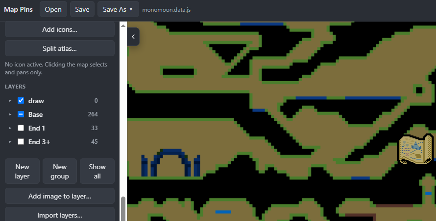

# Map Pins

A map editor that runs in the browser from a local file. Load a map image, add your own icons,
place them as markers and sort them into layers. Save the result as a PNG, or as a single HTML
file with a copy of the editor

Some browsers may not support save-in-place.

### [](https://monomoon-map.neocities.org)
### [Try it out](https://monomoon-map.neocities.org)

## Features

- **Map image.** Open any image as the map, and crop it in the editor.
- **Custom icons.** Add icon images by picking files or dropping them on the window. Icons
  that come as one sheet (an atlas) can be cut apart with the built-in atlas splitter.
- **Markers.** Click to place the active icon. Drag to move. Add labels maybe if you want idk.
- **Layers and groups.** Show or hide layers, drag them to reorder, ... uh, groups, group them up.
- **Image overlays.** You can add images for layer overlays. opacity and tools todo 
- **Pencil and eraser.** draw if you want
- **Import layers.** Copy chosen layers from another project. If the two maps
  are cropped differently, ~~good luck~~ I mean the offset between them is detected for you.

## Getting started

1. Open `index.html` in Chrome or Edge.
2. Click **Open map image** and choose your map.
3. Add icons under **Icons**. Select one and click the map to place it.
4. Click **Save** to write an HTML file you can open again later or send it to someone.

## Controls

| Action | How |
|---|---|
| Zoom | Scroll or pinch; `+`, `-`, `0` to fit |
| Pan | Drag the map; middle-drag while drawing |
| Place a marker | Click the map with an icon selected |
| Move a marker | Drag it; arrow keys nudge 1px, Shift + arrow 10px |
| Swap a marker's icon | Select the marker, then click another icon |
| Delete | `Del` |
| Deselect, stop drawing | `Esc` |
| Pencil, eraser | `P`, `E` |
| Undo | `Ctrl+Z` |
| Save | `Ctrl+S` |

## Saving

- **Save** writes the current file, asking where the first time and maybe the second and third times too.
- **Save As → HTML** save a copy of the editor packaged with your edits.
- **Save As → PNG** writes a flat image of the map with visible layers, markers and labels.
- **Open** loads a saved HTML file or a `.mappins.json` project.

Saving straight to a file needs the File System Access API, which Chrome and Edge have.
Firefox downloads the file instead.

## Keeping data in separate files

A map can keep its data in files next to the editor instead of inside one HTML file, which
suits version control. The page loads two data files before the editor:

```html
<script src="mymap.data.js"></script>
<script src="mymap.images.js"></script>
<script src="path/to/map-pins.js"></script>
```

- `mymap.data.js` holds markers, layers, groups and label settings, one item per line.
- `mymap.images.js` holds the map, icons and overlay images, one image per line, keyed by a
  hash of the content, so an unchanged image never shows up in a diff.

In such a page, **Save** asks once for the folder holding the data files and rewrites both.
Images stay as data URLs because browsers won't let a page read pixels from images loaded off
disk, and drawing, cropping and PNG export need those pixels.

## Files

| File | What it is |
|---|---|
| `index.html` | the blank editor |
| `map-pins.js` | the whole editor: styles, markup and code |

## License

MIT. See [LICENSE](LICENSE).
